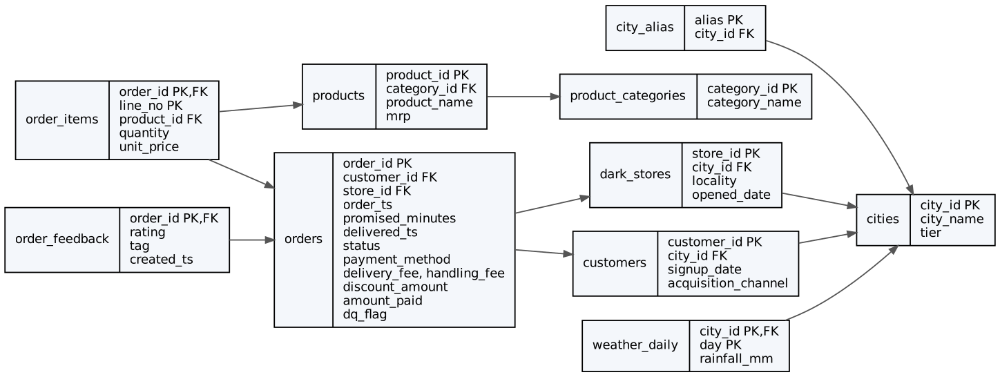
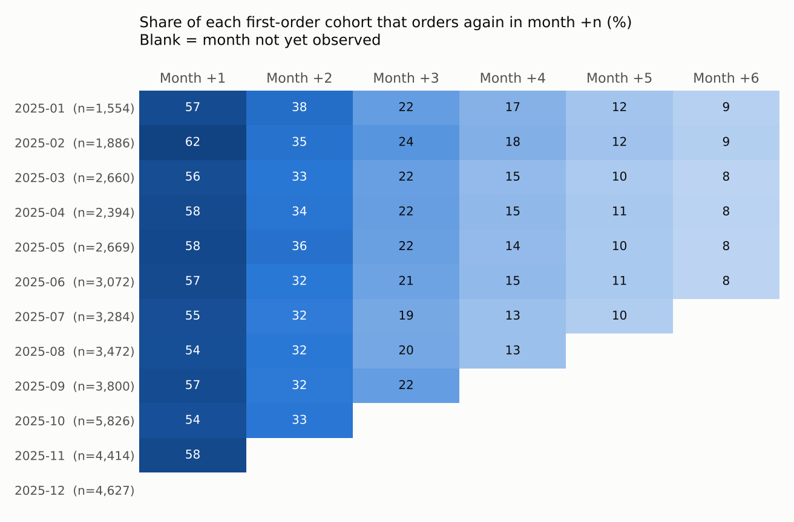
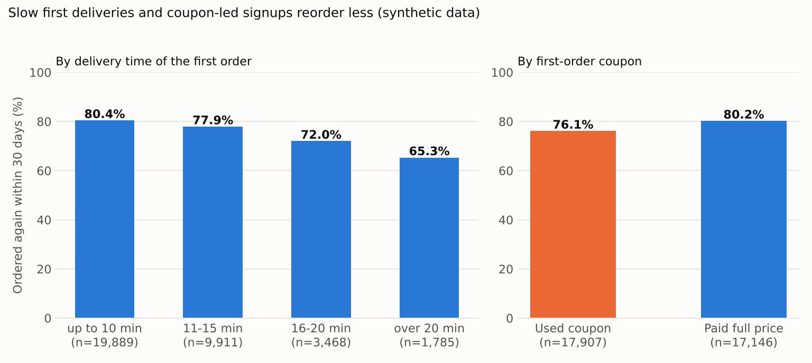
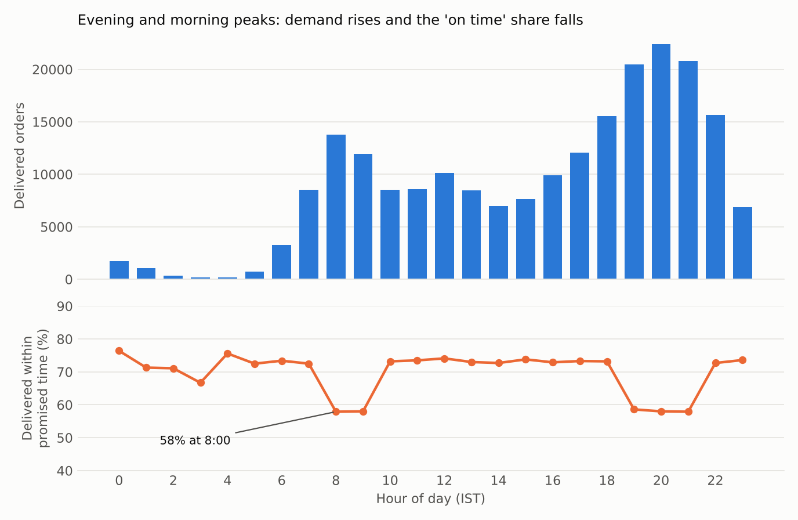

# Quick-Commerce Customer Retention and Delivery Analytics (PostgreSQL)

A SQL-first analytics project on a 10-minute-grocery-delivery business in India: schema design, data cleaning, 15 analytical queries, query tuning with `EXPLAIN ANALYZE`, and an independent cross-check of the results in pandas.

## About the data

**The data is synthetic.** Real quick-commerce order data is not public, so a seeded Python generator (`00_data/generate_synthetic_quickcommerce.py`) creates it. The structure is modelled on how Indian quick-commerce platforms work: dark stores, 10-minute and 15-minute delivery promises, ₹ pricing, handling fees, UPI payments, peak-hour surges, monsoon slowdowns and festival demand.

This project is **not affiliated with Blinkit or any other company** and uses none of their data. Every figure below describes the generated data and says nothing about any real business.

The generator builds in some known relationships (for example, slow first deliveries raise churn) so that the queries have something to find. The findings therefore show that the SQL recovers those relationships correctly. They are not discoveries about the real world. The generator also injects realistic mess (inconsistent spellings, impossible timestamps, duplicate rows) so the cleaning step has real work to do.

| Item | Size |
|---|---|
| Customers | 40,000 |
| Orders | 221,408 (Jan to Dec 2025) |
| Order lines | 672,481 |
| Cities / dark stores / products | 10 / 121 / 936 |

## Repository layout

```
00_data/          synthetic data generator (seeded, reproducible)
01_schema/        staging tables, CSV load, typed schema with constraints
02_cleaning/      data-quality report, transform, post-clean validation
03_analysis/      15 analytical queries (q01 to q15) + a shared base view
04_optimization/  materialized view, SQL functions, transaction demo, indexes, benchmark script
05_charts/        chart script
tests/            independent pandas re-computation of key numbers
results/          saved query output, benchmark table, execution plans
docs/             ERD and charts
run_all.sh        rebuilds everything end to end
```



## Pipeline

1. **Staging:** every column loaded as text, so no row is rejected at load time.
2. **Typed schema:** primary keys, foreign keys, `CHECK` constraints (for example a delivery cannot precede its order) and a `city_alias` table that maps spellings such as "Bombay", "Gurgaon" and "Hyderbad" to one city.
3. **Cleaning:** a raw data-quality report, then a transform that repairs or drops bad rows, flags every repaired order in `dq_flag`, and a validation pass.
4. **Analysis:** 15 queries, each saved with its output in `results/`.
5. **Optimisation:** materialized view, functions, indexes and a measured before/after benchmark.
6. **Verification:** key results are recomputed in pandas and compared with the SQL output.

### Data quality issues found and handled

| Issue | Rows | Handling |
|---|---:|---|
| Payment method written 16 ways | all | normalised to 5 methods |
| Delivered before it was ordered | 400 | timestamp nulled, row kept, flagged |
| Delivered with no delivery time | 300 | kept, flagged |
| Cancelled but with a delivery time | 150 | timestamp nulled, flagged |
| Double-posted order lines | 3,363 | de-duplicated with `ROW_NUMBER()` |
| Order lines with quantity 0 | 60 | dropped |
| Ratings outside 1 to 5 | 80 | dropped |
| Orders with several ratings | 754 | latest valid rating kept |
| City spellings needing the alias table | 18,746 | mapped; unmapped spellings fail loudly |

The cleaning is proved correct by a reconciliation check: for every order, `amount_paid = sum(lines) + fees - discount`, with 0 mismatches after de-duplication.

## Analysis queries

| # | Question | Techniques |
|---|---|---|
| 01 | Monthly GMV, AOV and growth | `LAG`, running totals |
| 02 | Demand and on-time rate by hour | `generate_series`, `FILTER` |
| 03 | Monthly cohort retention (months +1 to +6) | cohort logic with a right-censoring guard |
| 04 | RFM customer segments | `NTILE` with deterministic tie-breaks |
| 05 | Top 3 customers per city | `DENSE_RANK` |
| 06 | Customers who never reordered, by channel | anti-join |
| 07 | Delivery time and SLA by city | `PERCENTILE_CONT` |
| 08 / 08b | Reorder rate by first-delivery speed and by first-order coupon | cohort comparison |
| 09 | Revenue concentration (Pareto) | `NTILE`, cumulative share |
| 10 | Dark stores with zero-order days | calendar grid, `CROSS JOIN LATERAL` |
| 11 | Top 3 products per category | `CROSS JOIN LATERAL` |
| 12 | Category affinity (support and lift) | self-join on baskets |
| 13 | Days between first and second order | percentiles |
| 14 | Delivery performance in rain | weather join, bucketing |
| 15 | Win-back campaign ROI under three scenarios | parameter CTEs |

## Results at a glance (synthetic data)

- **Retention:** about 55 to 62% of each monthly cohort orders again the following month, falling to about 8 to 9% by month +6 (Q3).
- **Delivery speed and reorders:** customers whose first order arrived within 10 minutes reordered within 30 days 80.4% of the time. For first deliveries over 20 minutes the rate was 65.3% (Q8).
- **Coupons:** customers acquired with a first-order coupon reordered at 76.1% against 80.2% for those who paid full price. Their first baskets were also smaller, ₹431 against ₹508 (Q8b).
- **Peak hours:** orders peak at 8 to 9 am and 7 to 9 pm, and the on-time share drops from about 73% to about 58% in those hours (Q2).
- **Rain:** on-time delivery falls from 70.9% on dry days to 38.3% in heavy rain, and the average delivery time rises from 9.8 to 14.4 minutes (Q14).
- **Concentration:** the top 20% of customers account for 54.3% of delivered revenue (Q9).
- **Segments:** 8.2% of customers are Champions (10+ orders, recently active) and generate 24.1% of revenue. At-risk regulars are 23.8% of customers and 30.2% of revenue (Q4).
- **Cities:** Mumbai has the lowest on-time rate (62.3%) and Ahmedabad the highest (73.2%) (Q7).
- **Win-back:** targeting 17,482 lapsed customers breaks even at a 1.29% reactivation rate. Net profit is ₹11,603, ₹31,947 or ₹59,072 at 3%, 6% or 10% reactivation, under the assumptions written in the query (Q15).
- **Time to second order:** the median is 5.6 days (Q13).





## Query optimisation

Median of 7 runs on PostgreSQL 16, data fully cached (`results/explain_before_after.md`; full plans in `results/plans/`).

| Query | Before (ms) | After (ms) | Speed-up |
|---|---:|---:|---:|
| One customer's order history | 12.7 | 0.3 | 36.5x |
| Daily revenue for one week | 17.2 | 5.1 | 3.3x |
| Units and revenue for one product | 23.7 | 2.1 | 11.5x |
| One dark store, one day | 12.9 | 0.1 | 93.7x |
| Q8 (full analytical query) | 473.1 | 457.4 | 1.0x |
| Q11 (top products per category) | 1,632.5 | 1,622.9 | 1.0x |

Indexes made selective lookups much faster. They did nothing for the two full-scan analytical queries, because those read most of the table either way and the planner correctly kept sequential scans. Speeding those up would need pre-aggregation (such as the materialized view) rather than another index.

## Lessons learned

- An `EXISTS` inside an aggregate `FILTER` or a `SELECT` list becomes a per-row subplan. Moving it into `WHERE`, or rewriting it as a join, took one query from a timeout to under two seconds.
- Use `NOT MATERIALIZED` CTEs when the planner needs statistics from the underlying tables.
- `NTILE` needs a deterministic tie-breaker. Without one, the materialized view and the original query disagreed on segment membership, and the pandas cross-check caught it.
- psql variables are not expanded inside `$$` function bodies; use `set_config` / `current_setting` instead.
- Check for right-censoring in cohort analysis: a customer acquired last month cannot yet show month +3 behaviour.

## Limitations

- The data is synthetic, so effect sizes (such as the 15-point reorder gap) reflect generator settings.
- January GMV and the first quarter's growth rates reflect the business ramping up from zero customers in the simulation, not seasonality.
- The December cohort has no observed follow-up months, so it is blank in the retention table.
- The win-back economics (margin, coupon value, messaging cost, reactivation rate) are stated assumptions, not measured values.
- The benchmark covers a ~220k-order dataset on a single machine; behaviour at larger scale may differ.

## Tools

PostgreSQL 16, psql, Python 3, pandas, numpy, matplotlib, Graphviz.
